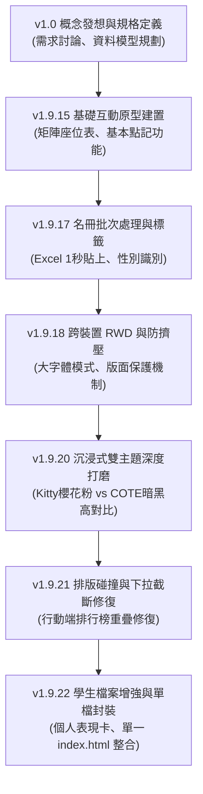

# ClassQuant Lite — 課堂量化點記板與班級經營互動 Web App

> 🌟 **作業主題**：用 Vibe Coding 做出一個互動網頁  
> 🔗 **網站公開展示（GitHub Pages）**：[https://albertstayhome.github.io/classquant-lite/](https://albertstayhome.github.io/classquant-lite/)  
> 💻 **GitHub 專案原始碼**：[https://github.com/albertstayhome/classquant-lite](https://github.com/albertstayhome/classquant-lite)  
> 📦 **架構說明**：本作品已依作業規範整併為**單一 `index.html` 檔案**，CSS 與 JavaScript 完整內嵌，零外部打包依賴，雙擊即可直接離線執行與流暢互動！

---

## 📌 步驟一：產品規格書 (Specification Document)

### 一、 產品定位與核心理念
- **專案名稱**：ClassQuant Lite（課堂量化點記板）
- **核心目標**：解決國高中、國小教師在實體教室教學時「點名耗時、加扣分紀錄繁瑣、課後統計費時」的痛點。
- **產品形態**：零建置（Zero-Build）的純前端單一 HTML 互動式 Web App（支援 PWA 離線快取），適配電腦螢幕、平板與手機操作。
- **目標客群**：班級導師、各科科任教師、課堂經營者。

---

### 二、 核心功能規格矩陣

| 功能模組 | 功能名稱 | 規格與互動行為說明 |
| :--- | :--- | :--- |
| **模組 1** | **座位矩陣點記板 (`Matrix`)** | • 模擬教室真實座位排列（支援 4x8、5x7 等動態行列配置）。 • 點擊學生座位即時彈出或連鎖觸發加扣分。 • 支援單選、多選、全選與語音隨機抽籤功能。 • 內建預設加分標籤（回答正確 +1、主動發問 +2）與扣分標籤（分心遲到 -1、未帶課本 -1）。 |
| **模組 2** | **班級名單管理器 (`Roster`)** | • **1 秒 Excel 批次貼上**：支援從 Excel 直接複製「座號 姓名」快速貼上解析並建立名單。 • 學生性別與座號微調、座號自動補號。 • 多班級管理：支援導師班與多個科任任教班級切換。 |
| **模組 3** | **事後回憶補記視圖 (`Retro Log`)** | • 針對課後回想補記設計，提供「單號快選」、「雙號快選」、「全選反選」。 • 常用評語選單，可批次對多位學生一次性套用點數增減。 |
| **模組 4** | **統計戰情室與個人檔案 (`Dashboard`)** | • **即時統計運算**：點數即時加總與排行榜動態更新。 • **Chart.js 視覺化**：整合四象限散佈圖與個別學生綜合能力雷達圖。 • **學生個人檔案卡**：查看個別學生的歷史記點明細、晤談紀錄與表現趨勢。 |
| **模組 5** | **雙主題切換視覺系統 (`Themes`)** | • **三麗鷗粉嫩主題（Hello Kitty 🌸）**：溫馨親切風格，適合國小與日常課堂。 • **高度育成暗黑主題（COTE OAA 🏛️）**：高對比黑紅科技風，搭配專屬角色卡片與動漫彩蛋音效。 • 一鍵即時無縫切換，CSS 變數全域響應。 |

---

### 三、 技術架構規格
1. **單檔整合（Single-File Architecture）**：
   - 核心樣式（CSS）與業務邏輯（Vanilla JavaScript ES6+）全部收攏於單一 `index.html`。
   - 不依賴任何 Node.js / Webpack / Vite 建置流程，任何現代瀏覽器皆可本機直接執行。
2. **輕量 CDN 擴充庫**：
   - **Tailwind CSS (CDN)**：快速構建現代化 RWD 響應式介面。
   - **Chart.js (CDN)**：提供高互動性的統計圖表與五數綜合箱形圖。
   - **Lucide Icons**：清晰現代的向量圖標庫。
3. **資料儲存與離線優先 (Offline-First)**：
   - 本地儲存：全系統數據自動保存於瀏覽器 `LocalStorage`，保障學生隱私且完全無需架設資料庫。
   - PWA Service Worker：快取靜態核心資產，斷網離線環境下依然 100% 正常開啟。

---

## 🤖 步驟二：Vibe Coding 協作與迭代歷程 (AI Iteration Log)

本專案自發想到完成，完全採 **Vibe Coding（自然語言提示詞 + AI 協作編程）** 模式進行，經歷多輪需求演進、Bug 修復與架構優化：

### 🔄 迭代版本演進里程碑

#### 1. 需求發想與規格對齊（人機討論）
- **發想痛點**：「老師上課一手拿粉筆、一手拿平板，操作點名跟加扣分若超過 2 個點擊步驟就會被放棄使用。」
- **AI 規格聚焦**：與 AI 討論後，確立了「單擊快速加分」、「雙擊進階紀錄」、「按鈕熱區防誤觸」的三大互動交互守則。

#### 2. 多輪測試與反覆調校（Vibe Coding 實戰優化）
- **迭代 1（名冊匯入體驗）**：傳統手動輸入 40 名學生姓名極度痛苦。向 AI 下達提示詞，設計出正規表達式解析器，讓老師直接複製學校 Excel 試算表兩欄，貼上即可自動拆解座號與姓名。
- **迭代 2（行動端版面防擠壓）**：在手機或投影機大字體設定下，座位卡與班級下拉選單曾出現文字換行被截斷的問題。透過 AI 協作導入 `--app-font-scale` 彈性文字防擠壓機制與 Clamp 動態計算。
- **迭代 3（高對比主題調色）**：在暗黑模式（COTE OAA）下，原本的文字對比度在舊型投影機上不夠鮮明。向 AI 提出對比度增強需求，全面重構語意化色彩變數（玫瑰紅、翡翠綠、琥珀黃）。
- **迭代 4（單一檔案架構收斂）**：依據課堂作業嚴格規範，透過腳本將分離的 5 份 CSS 與 18 份 JS 模組，完整封裝至單一 `index.html`，保證離線單檔開啟依然毫無相依性問題。

---

## 📸 步驟三：網站介面與功能展示

| 介面 / 功能 | 預覽說明 |
| :--- | :--- |
| **課堂座位點記矩陣** | 實時顯示班級學生座位、當前累積點數與即時加扣分操作卡片。 |
| **1 秒 Excel 批次貼上** | 彈窗文字框直接貼上試算表文字，自動解析並生成全班座位。 |
| **統計戰情室** | 包含全班加扣分走勢圖、四象限常規分析圖與各座號實力榜。 |
| **雙主題一鍵切換** | Hello Kitty 櫻花粉（親切溫馨）vs 高度育成 OAA（高對比黑紅科技風）。 |

---

## 🎯 結論與心得

透過這次 Vibe Coding 的實踐，深刻體會到現代網頁開發已不再是死記語法，而是：
1. **精準把需求與規格說清楚**（梳理清晰的規格書）。
2. **與 AI 協同迭代**（透過敏捷對話找出邊界情況與 UI 缺陷）。
3. **工程化交付**（從模組化程式碼優化並打包收斂為標準單一 `index.html`，並透過 GitHub Pages 自動化公開發布）。
